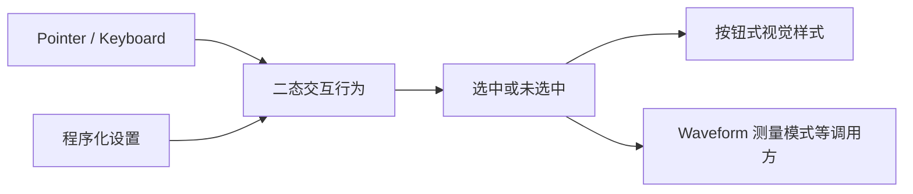

# 通用二态 Toggle Button

## 独立目标

提供可复用的二态 Toggle Button，以供 Waveform 的矩形测量模式使用，并允许其他 UI 场景直接复用。它是一个**独立功能增量与独立提交**，不把通用 Toggle 行为埋进 Waveform crate 内部。

## 为什么不直接改 CheckBox 样式

现有普通 `WidgetryCheckBox` 基于 Bevy 官方 `Checkbox`、`Checked`、`ValueChange<bool>` 与 `checkbox_self_update`，二态状态和用户交互可以复用。但是其 Scene 内置固定的方框和勾选图标，且对无障碍树声明的是 CheckBox 语义，不能简单把颜色调成按钮而认为语义正确。

因此复用底层二态输入与状态机制，不为 Toggle Button 重新实现完整的 Pointer/Keyboard 状态机；独立组织可保持激活外观的按钮式 Scene，并建立与用途匹配的可访问语义。具体共用私有模块还是调用官方 headless 组件，由实现阶段依据依赖决定，不强迫旧 CheckBox 改变外观或自身 API。

## 行为和接口

- 未选中表现为普通按钮；点击切换为选中，外观持续表示激活；再次点击取消。不是按住时才激活的瞬时按钮。
- 提供外部查询及程序化设置状态的入口，符合现有 Widgetry 的自有 state 更新/通知约定；合法同值不产生多余状态变化，失效目标返回可诊断错误。
- 用户输入改变二态状态后，消费方可以同步获取新状态。Waveform 应通过这份状态控制测量模式，而不是维护与按钮外观可能分叉的第二份不可追踪开关。
- 支持 Disabled、正常焦点/键盘交互、主题及配色覆盖。Toggle 不继承 CheckBox 的固定方框/勾选视觉，也不假设 CheckBox 的角色就是按钮角色。
- 不为本控件添加泛用的群组互斥、三态循环、播放控制、对话框等功能；它只做一个语义完整的二态控件。

## 验证和依赖

验证鼠标、键盘、焦点、Disabled、程序化设置、同值写入、主题切换、选中状态的持续样式及无障碍声明。Waveform Gallery 中可直接使用它切换矩形测量模式，但通用 Toggle 的基础测试放在自身控件测试里。

**与前后方案的关系**：它是独立于 Waveform 核心渲染的通用控件，按本条执行顺序先交付；紧随其后的矩形测量以它作为 UI 开关，不重新发明 Toggle。已实现的 Slider 与本增量不是同一种控件，也不在这里改造。
