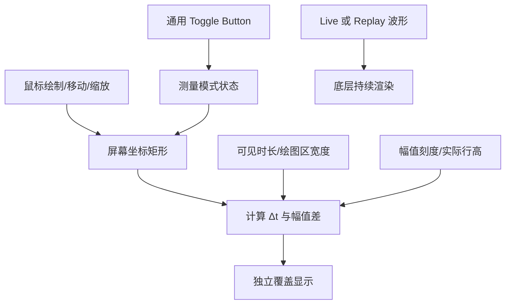

# Waveform 独立矩形测量覆盖层

## 目标与基本机制

在 Live / Replay 两种模式中复用同一套屏幕坐标测量工具。用户可以在波形视口上拖动画出矩形，通过矩形宽度与高度计算时间跨度和幅值差。**这不是在数据上选择某个通道或某组真实样本**；其计算只依赖当前时间范围、统一幅值刻度、实际通道行高、绘图区尺寸和独立测量开关。

覆盖层的位置位于波形绘图区之上，标签、顶部控制栏和底部时间轴各自处于独立区域。覆盖层不改变 WaveformSource、播放时钟或采集进度；即使波形继续向左滚动，保留的矩形也保持在视口上的同一位置。

## 交互状态与编辑行为

- 顶部通用控制栏使用 Toggle Button 切换矩形测量模式；开关状态支持程序化设置。关闭时立即清除矩形和测量结果；重新开启从空白开始，属于“即开即用”，不隐藏保存旧矩形。
- 测量模式开启后，在可绘制空白区域按下并拖动会新建矩形。如果之前已有一个，新的替换旧矩形；同一时刻最多一个测量矩形。
- 鼠标松开后**保留**矩形和结果，不立即消失；之后可以抓住矩形内部拖动整个矩形而不改变宽高，因而时间差/幅值差也不变。
- 可以抓住四边或四角改变矩形尺寸，计算结果实时变化；触点判定必须区分拖动矩形与拖动边缘，不能因为波形正在滚动而改变手势模式。
- 测量时 Live 继续实时更新；Replay 正常播放也不自动暂停。如需静态测量，由用户独立点击 Replay 暂停按钮。
- 所有移动、缩放都限制在波形绘图区有效区域；不侵入左侧标签、横轴刻度或控件工具栏。输入取消、失焦、控件隐藏时必须正确结束手势，不留下被捕获的 Pointer。

## 换算与动态显示

设波形绘图区宽度为 `W`，当前完整显示时长为 `T`，矩形宽度为 `w`；每条通道实际行高为 `h`，幅值预设为对称单侧上限 `A`，矩形高度为 `r`：

\[
\Delta t = (w/W)T, \qquad \Delta V = (r/h)\,(2A)
\]

这里的高度可以跨越多个通道，甚至多倍于单个通道高度；`ΔV` 是**屏幕幅值尺度差**，不代表任何单条通道两点的真实电位差，也不绑定矩形落在哪条通道。当前内部统一使用 V，展示时依照幅值预设选择 µV/mV/V 等合适显示单位。数值展示需要清晰标出 `Δt` 与幅值差及单位。

矩形以屏幕位置和尺寸为真值：切换 `10s → 20s`，原本显示 `Δt=2s` 的固定矩形应变为 `4s`；改变幅值刻度、实际通道行高、每屏通道数量或窗口大小时亦基于当前比例尺立即重新计算。布局改变而矩形超出绘图区时约束到合法位置，不将矩形改成绑定样本时间戳的历史区间。

## 与模式、会话和渲染的关系

同一个测量层既用于 Live 又用于 Replay，二者正常运行不受测量影响。矩形只覆盖波形视口，既不把时间轴暂停，也不参与降采样、网格计算和通道数据读取。切换数据源会话时清除旧矩形；测量 Toggle 的选中状态作为显示配置保留（如仍开启，则以空矩形开始）。关闭测量模式时解除其对波形区域的测量手势占用；Waveform 本次不在关闭时提供横向拖动历史数据的行为。

## 验证

测试单通道内框选、跨 2～3 个通道框选、极窄/极高矩形、移动与四边四角编辑、关闭并重开、Live 持续滚动中测量、Replay 播放及暂停状态下测量、改变时间与幅值预设、调整每屏通道数及窗口大小时数值重新换算。Gallery 检查覆盖层没有侵占标签列，矩形下波形仍持续绘制，输入交互不会中断采集或回放。

**与前后方案的关系**：依赖通用 Toggle、时间范围、幅值投影和实际通道行高；独立于具体采样算法和数据源内容。
