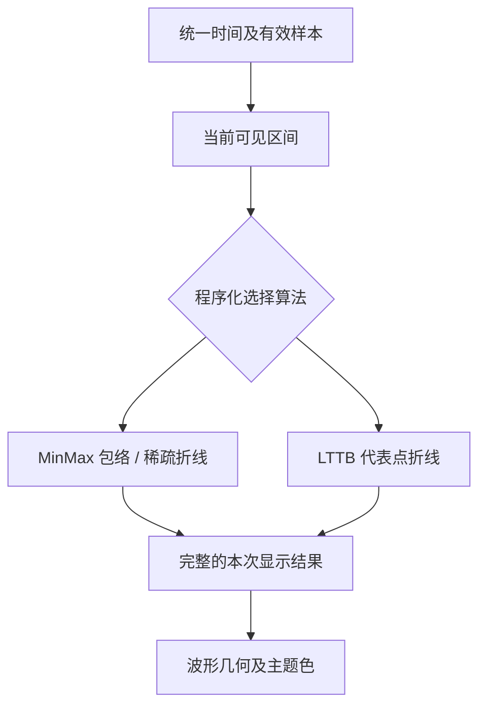

# Waveform LTTB 降采样与运行时切换

## 目标与设计思路

在已有 `MinMaxReducer` 基础上增加 **LTTB（Largest Triangle Three Buckets）**，Live 和 Replay 都可以选择算法，并且允许运行期间程序化切换，采集或播放不被暂停。算法选项**不内置在 Waveform 工具栏中**，应用可以通过公开 API 设置；Gallery 独立提供用于对比的算法 ComboBox。

两个算法面对的输入是同一份已校准物理样本以及同一可见窗口、相同缺口语义和同一输出像素密度。算法切换仅改变用于显示的表示方式，不改变会话时间、数据源、幅值范围、通道次序、垂直滚动或网格状态。

## Min/Max 与 LTTB 的差异

- **Min/Max**：给定时间桶保留最小值和最大值，在同等显示密度下保留尖峰/谷值，更适合目前的 EEG/ECG 等电生理波形，是默认算法。采样稀疏时可绘制原始折线，密集时使用包络。
- **LTTB**：划分时间桶，并利用前一代表点、当前桶候选点与下一个桶的平均点构成的三角形面积，选面积最大的点作为代表点。适合在有限像素宽度下保持折线的整体形状；**不保证保留所有极值**，因此只能作为明确可选的视觉算法。
- 两种算法都不能以缺失样本跨段连线；LTTB 的桶、代表点与下个桶平均必须考虑各有效段边界。需要处理最新尚未完整的桶，不因等待未来采集点而阻塞当前 Live 绘制。

LTTB 的当前窗口点集不能直接从已降采样的 Min/Max 桶结果反推。运行时切换到 LTTB 时，从原始有效点或 LTTB 专用数据表示生成所需结果；反之亦然。新的降采样画面准备好之前，保留旧的完整显示快照，不因切换算法出现半屏不一致。

## Live 下的运算与稳定性

Live 可使用外部数据源中当前窗口覆盖的原始样本构建 LTTB；不依赖预先保存到磁盘的索引。持续输入导致代表点可能随最新桶补齐而改变，需要避免明显的尾部跳动：只更新受影响的桶/窗口，并对未完成尾桶采用明确的有效点处理策略，保证新样本能及时显现。该策略必须尊重样本实际时间与缺口，不能伪造新点；允许在实施阶段决定适当的增量缓存方案，并据 Gallery 显示验证微调。

在算法切换或布局/时间范围调整时，允许重新规划计算，但不应同步执行无法控制的大量原始数据重扫来阻塞 UI。保持结果提交与时间轴一致；当前实现的 `WaveformReducer` 抽象可以作为重构参考，不要求保留现有的固定缓冲接口。

## Replay 与多分辨率读取的边界

Replay 使用所选算法对应的预处理索引加速大文件浏览：Min/Max 使用多级极值索引，LTTB 使用专门的多级代表点索引。**预览与松手后的最终画面始终采用同一算法**，不能拖动时默认改成 Min/Max、松开后再突然切换为 LTTB。即使同算法预览点数和最终窗口不同，代表点不一定逐点相同，仍要检验视觉一致性。索引文件的构造与随机访问归后续独立数据源方案。

## 验证

使用相同信号显示 Min/Max 与 LTTB 的视觉差异，特别加入幅度短促的尖峰，说明 LTTB 可能漏极值；验证持续采集期间切换算法、不同像素宽度、窗口热切换、边界桶、单通道缺口、尾部样本增加与多实例显示。核对切换不暂停时间源、不改变物理幅值与时间映射，旧算法结果不能覆盖新请求。性能敏感路径使用现有 crate benchmark 与 Gallery GUI benchmark 对比，性能问题按实测单独优化。

**与前后方案的关系**：基于统一读取与缺口契约；后续 Replay 多级索引必须分别支持两种算法，而不能只做 Min/Max 的缓存。
