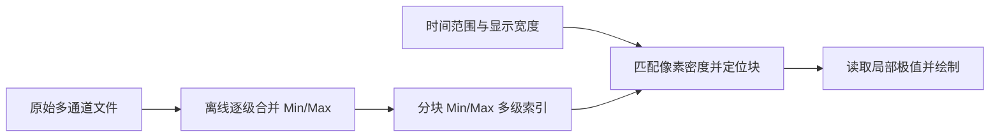

# Replay Min/Max 多级索引与真实磁盘读取

## 目标与核心机制

为 Replay 建立**可按时间范围、通道与像素密度随机读取的 Min/Max 多级索引**。原始长记录不必整份装入内存，也不必每次跳转都从原始数据重新计算极值。Waveform 不持有文件格式；外部数据源负责文件读取和多分辨率结果准备。

## 极值索引的构建与选层

每个 Min/Max 桶保存对应样本范围内的最小值、最大值及其覆盖的有效时间区间。相邻桶可由下层极值直接合并，故构建多级索引不需重复扫描整份原始文件。按通道、按时间块组织，使源可随机定位当前可见范围及必要边界，而不是按整份记录全量载入。

例如 64kHz 采样，显示 10s，宽度 1200px：一个通道原始有 640000 点，每像素约 533 点。快速预览可优先读取接近每 512 点一桶的索引层，渲染近似像素密度的极值包络，再视需要以更高分辨率生成最终波形。不能通过简单均值替代极值，以免损失短促峰谷。

分块及索引必须保留逐通道有效性。若某通道某段时间没有数据，该区间不能被零值补齐，不能把缺口两侧的点画成一条连续的折线或包络。来源单位、统一采样率和时间基准来自当前记录元信息，与预处理时使用的数据必须一致。

## 接口与请求一致性

Waveform 请求当前时间范围和显示分辨率，源负责定位分块、选择合适层级、准备对应 Min/Max 表示。API 不把专用文件格式、块大小、索引偏移公开为 Waveform 的固有概念。旧版 Gallery `ReplayAsset` 会 `read_to_end` 整份小文件并转成内存数组，不能用作本增量的大文件磁盘读取方案。

拖动时的新位置可以不断覆盖旧目标，等待中进度 Slider 自身继续响应；新 Min/Max 预览未就绪时，保留最后一帧已提交波形及其时间轴。对旧请求结果进行会话/目标身份校验，不允许它们覆盖最新结果。正常播放允许跳过过时的渲染帧；真正读取失败则暂停 Replay 并由外部处理。具体并行/异步实现须避免在 UI 渲染循环同步阻塞大量 I/O，不另外开发一套通用 Job 框架。

## 文件准备与验证

索引生成属于数据源离线构建能力；最终的本地文件准备命令和大型 Gallery 压测页面在后续独立基础设施方案中接入。原始大文件与索引不应提交 Git；可以继续保留现有小型 `.wfrm` 作为基础显示样例。

验证多分辨率层级的极值精确性、宽窄窗口、跨块随机读取、缺口和短尖峰保留、异常源读取、持续快速更换请求、文件体积远大于屏幕工作集等。检查实际 I/O 和工作集随可见区间/输出像素规模变化，而非随整份录制时长线性增长。

**与前后方案的关系**：依赖会话、有效性和 Min/Max 输出契约；下一份 LTTB 索引与其共享多分辨率随机访问思想，但不把 Min/Max 的结果当作 LTTB 的数据。
