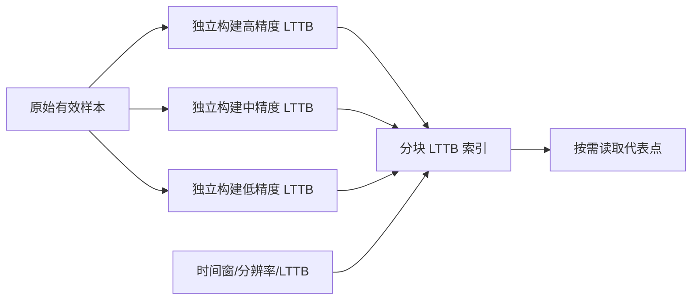

# Replay LTTB 多级代表点索引

## 独立目标与设计思路

在 Replay 已能进行多级索引随机读取后，加入**与 Min/Max 并列的 LTTB 预览索引**，使选中 LTTB 时的快速拖动预览和最终波形都使用 LTTB 的视觉表达，而不是拖动时先显示包络、松开后突然切成折线。

## 为什么不是逐级重新压缩

LTTB 把原始样本分桶，依据前一个代表点、候选点和下一桶均值组成的三角形面积选点。结果不仅取决于当前桶，还依赖相邻上下文，因此**对已经 LTTB 化的数据再次运行 LTTB，不保证与直接对原始样本计算相同目标点数的结果等价**。本方案要求各预览层级以原始有效样本为基础独立构建，不用上一层代表点替代原始数据，也不用 Min/Max 的极值桶代替代表点。

必须按可随机查询的时间或样本范围分块。若仅对一小时文件整体生成一条低分辨率折线，用户放大观察 `125～135s` 无法获得合适局部细节。源应根据当前窗口、像素宽度和各层点密度选层，读取相交的块与必要的相邻上下文，处理跨块时的桶和代表点。块独立选点不必与对整个当前窗口运行一次 LTTB 完全一致；最终画面可对完整目标窗口更细地重选点。

## 算法一致性与有效数据

- 当前所选算法是 LTTB 时，**预览与最终绘图都使用 LTTB**，不得默认偷换成 Min/Max。分辨率不同可能导致代表点少量变化，但不应突然改变绘图类型。
- 原始信号中的尖峰不保证被 LTTB 保留，这是算法特性，应通过 Gallery 与 Min/Max 对比明确展示。不能宣传为与极值包络等价。
- 逐通道缺口要阻断候选点区间，不能通过三角面积选择把缺口两侧连为一条线。
- 采样率、单位声明、时间轴起点、源标签与原始文件保持对应。索引按通道组织，满足多通道随机访问。
- 快速拖动时新结果未准备好，保留旧波形与旧时间轴；新位置优先、旧任务不能覆盖最新请求。算法切换时对应索引已准备好才显示新算法的完整结果。

## 验证

在真实落盘记录中覆盖不同时间长度、局部转折、大幅尖峰、缺口、跨分块边界和快速随机 seek。检查 LTTB 预览/最终同算法、没有非法跨段连线、代表点保持真实采样时间顺序。对比 Min/Max 和 LTTB 的 CPU/I/O 成本与视觉差异，确认用户热切换时不会阻塞时钟或遗留旧算法画面。

**与前后方案的关系**：沿用已建立的多分辨率请求和真实文件访问框架，实现独立的 LTTB 代表点索引能力；后续 Replay 播放及拖动可按照当前算法选择相应数据源输出。
