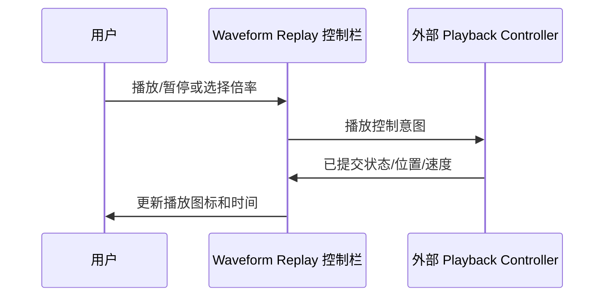

# Replay 基础播放控制栏

## 目标与职责

为 Waveform 的 Replay 模式增加可直接使用的**播放/暂停按钮、当前时间与总时长展示、播放速度 ComboBox**，并保留放置播放进度 Slider 的布局位置。Replay 控制栏内置于 Waveform，而播放时钟、实际文件读取、采集/回放业务仍归外部 Playback Controller。

## 位置与外观

控件竖向结构为：顶部通用控制栏（时间范围、幅值范围、每屏通道数、测量 Toggle）→ 左侧标签与波形视口 → 横轴时间刻度 → **Replay 专用控制栏**。Live 模式不创建 Replay 控制栏，也不保留空白高度。

- 播放/暂停按钮只显示三角形或暂停双竖线图标，**不显示文字，也不附加 Tooltip**。
- ComboBox 候选倍率由应用提供（例如 0.25×、0.5×、1×、1.5×、2×、4×），已选项直接显示 `1×` 这样的值，不额外显示“播放速度”文字或 Tooltip。默认 1×；应用也可以程序化改变倍率。
- 当前播放位置与完整记录总时长以数值文本展示，例如 `00:35 / 01:40`。时间数值由 Playback Controller/元信息提供，而非从波形几何估算。
- 波形区不额外绘制 Replay 当前时间游标线，也不支持用鼠标水平拖波形浏览历史；播放位置后续由进度 Slider 的 Thumb 标明并可操作。

## 正常播放状态

- 新 Replay 记录加载后**暂停在 0s**，外部应用可主动开始播放。
- 回放时钟按设定倍率前进，如 2× 表示每经过 1s 真实时间目标播放时间前进 2s。外部控制器执行实际时间推进，Waveform 接收位置并调整显示区间。
- Replay 采用 Live 同款连续跟随窗口：选择 10s 时，播放到 6s 显示 `[0,10]`，左侧已有 6s 波形、右侧空白；播放到 15s 显示 `[5,15]`；80s 显示 `[70,80]`。暂停时绘图区与轴同时冻结。
- 到达总时长时在末尾停住、保留最后一屏波形，播放图标复原；再次点击播放从 0s 重播，**不自动循环**，原倍率保持。
- 更换数据源/Live→Replay 时重新建立回放状态、归零暂停和元信息，但保留时间/幅值/每屏通道数、网格、纵向滚动意图、算法选择及倍率等持久设置。重置旧矩形。
- 正常播放若数据读取暂时跟不上，时钟与位置仍按倍率前进，渲染可以丢弃旧帧；旧波形和旧轴按成对快照保留。真正的读取错误要暂停并对外报告，不无限循环重试。

## 状态同步与验收

播放按钮、速度 ComboBox、外部程序化控制和 Playback Controller 的实际状态必须保持一致。Waveform 传递用户意图，但不能在外部拒绝/报错后留下虚假的“正在播放”显示；组件同步遵守已提交状态权威。受影响的会话变更要取消旧结果，不能把旧记录的播放位置写入新记录。

Gallery 验证默认暂停、从头开始、改变倍率、暂停/继续、播放到末尾重新播放、程序化切换模式、加载不同总时长和通道数文件，以及正常滞后和错误时钟行为。**不在本方案中实现 Slider 手势预览**，进度控制的读写和拖动生命周期由紧接的独立子方案完成。

**与前后方案的关系**：依赖 Replay 源元信息和显示快照提交规则。紧随其后的通用 Slider 手势生命周期增强可独立实现，随后 Replay 才接入 Slider 进度拖动和实时预览；基础控制栏与拖动预览是两个可分别验收的增量。
