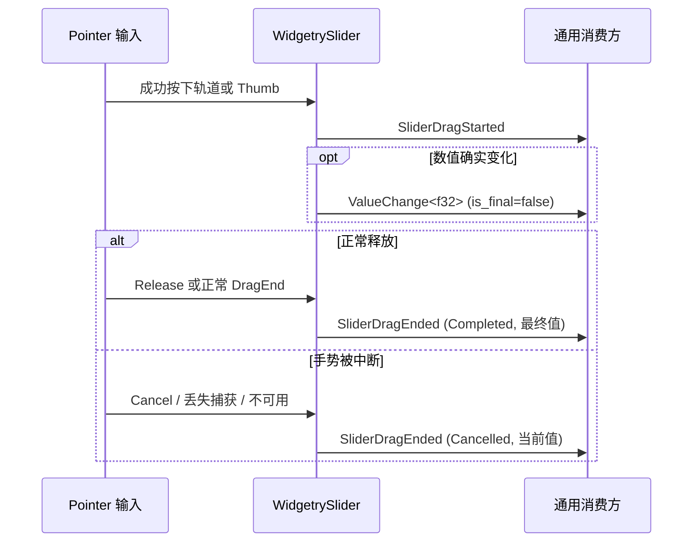

# 通用 Slider 拖动生命周期通知

## 独立目标

增强既有 `WidgetrySlider` 的公开交互契约，可靠表达一次 Pointer 手势的**开始、正常结束和取消**。Slider 继续负责通用数值选择，消费方可以独立识别手势边界；Waveform Replay 由此知道何时暂时停止播放时钟、何时结束预览并恢复原有播放状态。

当前 Slider 的 `ValueChange<f32>` 只在值实际改变时发出：拖动期间 `is_final=false`，键盘或程序化更新 `is_final=true`。用户按住 Thumb 但没有移动时不会产生值变化；移动后松开也不补发同值通知。这意味着 **`is_final` 不能代替 Pointer 手势的完成信号**，也不能靠第一次值变化识别开始。

## 公开事件和数据契约

在 Slider 的公共模块提供独立于数值变化的手势事件：

- `SliderDragStarted`：**成功建立 Pointer 手势时**发出，包括按住 Thumb 未移动，以及点击轨道立即改值的情况。事件能识别 Slider 根 Entity，并提供开始时的数值；一次手势只触发一次。
- `SliderDragEnded`：手势实际终止时发出，携带 Slider 根 Entity、终止时已经提交的当前数值，以及**`Completed` / `Cancelled`** 两种结果。一次已开始的手势恰好收到一次终止通知。
- 事件类型只表达通用手势生命周期，不包含播放状态、seek、采样时标、波形数据或特定应用的业务动作。上述名称是此方案的公开语义建议；实现时保持清晰、一致的类型命名及导出即可。

`ValueChange<f32>` 仍表达**数值发生实际变化**，`is_final` 仍指这次值变更的语义，而不是“拖动结束”。事件可以与 ValueChange 并存，但不能把一个无变化的 Release 伪造为新的数值变化；也不把松开操作塞入 `ValueChange::is_final=true` 试图解决缺口。

一次合法按下在引发轨道数值变化之前，先让消费方可靠获知开始边界；因而 Replay 能先保存并暂停播放状态，再处理 seek 目标。事件均以根 Slider 为可识别目标/来源，避免消费方必须观察 Thumb、Track 或 Slider 私有的 `DragState`。

## 手势结束与取消路径

Slider 当前已有 Pointer Capture 和私有 `DragState`；这次直接增强现有手势处理路径，而不为旧实现增加并行兼容逻辑。成功开始时建立活动手势身份，所有结束入口复用**一次性结算**：

- **正常结束**：Primary Pointer Release，或同一手势后续发出的正常 DragEnd。两种事件可能先后到达，但只能结算一次。
- **取消结束**：Pointer Cancel、控件或祖先 Disabled、隐藏/不可交互、窗口失焦、有效 Pointer 或捕获失效等现有 `cancel_unavailable` 路径。即使没有值变化，仍必须结束手势并发出取消结果。
- **没有开始就没有结束**：因非 Primary 按键、已被其他控件捕获、Disabled、位置非法等原因拒绝的 Press，不得产生伪开始或伪结束通知。
- **结束时值不变**：返回事件仍包含当前已提交值；不要求修改数值、不产生多余 `ValueChange`。取消仅表示手势非正常结束，不自动代表“回滚到开始值”；是否采用已到达的数值由消费方决定。

手势的清理、Pointer Capture 释放、`Pressed` 移除和生命周期事件必须使用同一条确切的结束路径；事件消费者能够在退出时清理暂时状态，不能发生重复结束或永久挂住。控件树被删除时的销毁路径若无法向已销毁实体正常触发事件，需要在消费方同样能够感知实体/会话销毁并清理悬挂状态。

## 与现有输入及运行时 API 的关系

本方案不改 Slider 单值 `f32` 模型、一次性 `min/max/step/orientation`、程序化 `value()` / `set_value_in_world()` / `set_value()`、主题/样式、Thumb 几何和键盘方向键逻辑。**程序化更新和键盘改值不是 Pointer 拖动**，仍只发其原本的数值变化通知，不合成 DragStarted / DragEnded。

不需要保留对旧事件使用习惯的兼容分支。需要调整已有 Slider 的观察者、事件命名或内部手势 API 时直接收敛到一套权威事件模型；不为“旧实现也要能用”保留两种彼此矛盾的生命周期定义。新增的公共事件要由 crate 和 facade 可见，并同步 Rustdoc 与 `docs/crates/slider.md` 中的事件语义。

## 验证与交付

本增量可独立合入通用 Slider，不依赖 Waveform。Slider 自身单元与集成测试至少覆盖：按住 Thumb 未移动仍 Start/End；点击轨道的开始通知发生在其值变化前；拖动数值多次变化而开始/结束各一次；松手当前值不变仍有 Completed；Release 和 DragEnd 双路径不重复；Cancel / Disabled / 隐藏 / 失焦 / Capture 丢失各自结算 Cancelled；无效 Press 不产生命周期通知；键盘与程序化更新不产生命周期通知；`ValueChange` 的真实改变、`is_final` 含义不被手势事件污染。

GUI/BRP 实测 Pointer Capture 及鼠标离开 Thumb 后释放、窗口失焦后的重新拖动，确认不会遗留 Pressed 或活动手势；必要时同步 Slider Gallery 展示和相关测试覆盖。完成后，Replay 不需要复制 Slider 的 Pointer/DragState 代码，只订阅公开生命周期与 `ValueChange<f32>`。

**与前后方案的关系**：前一份 Replay 基础播放栏可不依赖此事件增量；后续 Replay 进度拖动预览明确依赖这里提供的公共生命周期契约。这是一次可独立验收和提交的 Slider 功能增强，不以最终 Replay GUI 测试代替自身的测试。
