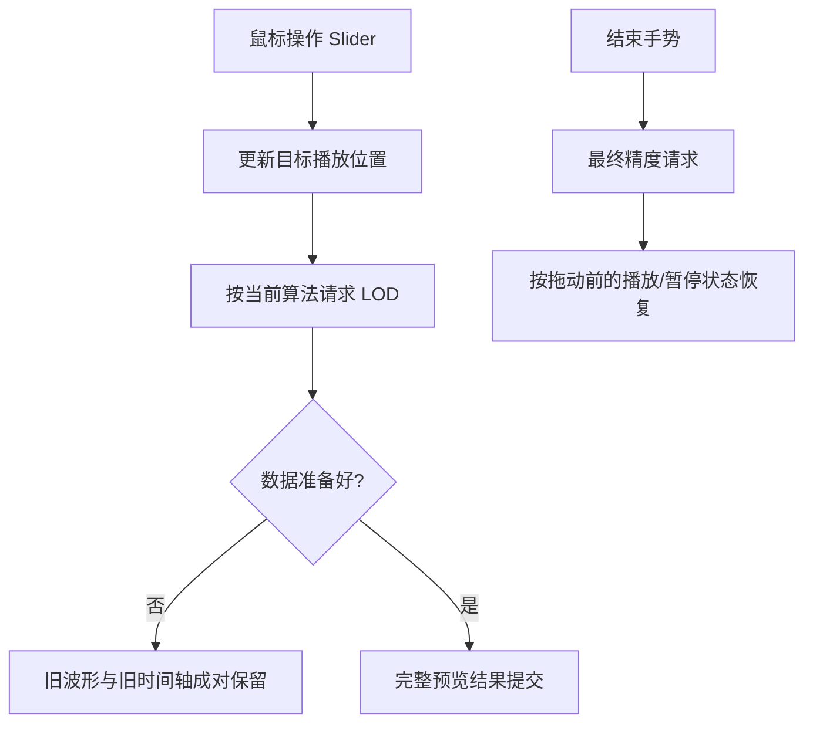

# Replay 进度 Slider 与实时拖动预览

## 独立目标

把现有 `WidgetrySlider` 作为 Replay 播放进度控件，并接入真实文件源的**快速拖动预览、松开后的最终波形更新及播放状态恢复**。Slider 绘制进度、已完成 Fill 和可拖动圆形 Thumb，用户无需再为 Waveform 单独组装 Slider 或开发新的进度条控件。

## Slider 的能力及范围映射

已存在的 `WidgetrySlider` 为 `f32` 单值模型，支持水平轨道点击、Thumb 拖动和 Pointer Capture，程序化调用 `set_value_in_world()` / `set_value()` 可更新数值；有效更改后发送 `ValueChange<f32>`。`min/max/step/orientation` 是一次性 Props，构造后范围固定。

由于替换 Replay 文件会更改总时长，组合层可将 Slider 区间固定为 `0..1`（归一化播放进度），通过当前记录的总时长将进度映射到精确的回放时间。真实播放位置权威不依赖单个 `f32` 秒数，应以足够精度的 Duration 或采样时标表示；外部更新进度 Slider 时避免双向事件回写造成重复 seek。

## 用户操作与时钟

- 鼠标按下或开始拖动时，**临时暂停播放时间推进**，记住拖动前是播放还是暂停、以及当前倍率。只有数值变化时才感知拖动是不充分的，因为用户可以按住 Thumb 完全不移动。
- 拖动过程中 Slider 位置立即跟随鼠标，不等待 I/O。对鼠标频繁变化合并预览请求，按当前的 Min/Max 或 LTTB 索引读取合适 LOD；旧请求不得覆盖新目标，不能每个像素位置都强制读取完整原始窗口。
- 预览尚未准备好时，**Slider 显示新目标，但波形和时间轴都保留上一份完整提交**。不得让新轴配旧波形，以免误读。
- 结束手势时，最终播放目标以松手时的位置为准，再读取最终精度的对应算法波形。原本正在播放则从新位置按原倍率继续，原本暂停则继续暂停。外部 Playback Controller 负责真正的时钟暂停与恢复。
- 当播放控制直接通过程序化 seek 改变位置时，也要与 Slider 的当前值及波形请求保持一致。正常播放的数据准备短暂滞后时，位置和滑块继续推进，允许跳过过时视觉帧。
- Pointer 释放、Cancel、DragEnd、捕获失效或窗口失焦统一消费 `SliderDragEnded` 的结束结果，不得使临时暂停状态永久悬挂。

## 接入已增强的 Slider 手势接口

前一份通用 Slider 子方案直接在现有控件内新增 `SliderDragStarted` 和 `SliderDragEnded` 两类公共通知；后者携带结束时的当前值，并区分 `Completed` 与 `Cancelled`。这项增强不另做兼容层，Replay 也不访问 Slider 的私有 `DragState`、Thumb 或内部 Pointer Capture。

- `SliderDragStarted`：即使用户按住 Thumb 没有移动也能收到。Waveform 将拖动前播放状态与倍率交给外部 Playback Controller 暂存，并暂时停止时钟推进；轨道点击改变数值前，应已建立这一手势状态。
- `ValueChange<f32>`：在实际改变时发送，拖动阶段 `is_final=false`；将归一化值映射为最新 seek 位置，合并过时请求，但不据它识别按下或松手。键盘及程序化写入仍按一般 seek 更新流程处理，不能误判为拖动手势。
- `SliderDragEnded(Completed)`：即使最后数值未变化也能收到，按事件中的最终值提交目标和最终精度读取，并释放临时播放暂停状态；按先前播放/暂停及倍率约定恢复。
- `SliderDragEnded(Cancelled)`：结束临时拖动状态，不让播放时钟永久挂起。终止事件携带最后已提交数值，Replay 不应仅因取消就假设 Slider 已自行回滚；取消场景的目标结算以实际已提交位置和会话仍有效为准，禁止把旧会话结果写入新会话。

双向同步必须区分 Slider 的指针交互与程序化播放进度投影；Slider 的程序化 `set_value()` 可能发 `ValueChange<f32>`，消费方需要防止投影更新再次触发 seek 循环。对播放时钟所报告的精确时间仍以外部 Playback Controller 为准，Slider 的 `f32` 仅代表 UI 归一化比例。

## 验证

覆盖轨道点击、按住 Thumb 未移动、拖动后松手时值不变、快速反向/跨远距离拖动、取消/失焦/失去捕获、边界 0% /100%、录制总时长变化、外部主动定位与正常播放持续同步。核对 SliderDragStarted 触发的临时暂停先于轨道点击造成的 seek，SliderDragEnded 无论数值是否变化均能结束预览状态；正常结束和取消均不出现重复恢复或旧会话结果回写。对于两种算法，拖动期间都按本算法 LOD 预览、释放后按本算法生成最终结果；测量矩形仍与波形分离，Replay 没有额外的横向波形拖动功能。

在 Gallery 真实本地大文件上验证：Slider 不被磁盘 I/O 阻塞，旧请求完成不能反向拉回进度或波形，最终时间轴与最终画面匹配。视觉与性能问题记录实际复现和耗时数据，不人为引入慢速源来代替测试。

**与前后方案的关系**：依赖已增强的 Slider 公共拖动起止事件、Replay 基础播放控制及两种算法的多级索引；其状态机明确采用外部 Playback Controller，而不是由 Waveform 自己实现文件播放计时。
