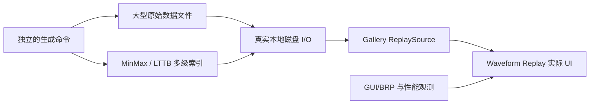

# Gallery 本地大文件演示与性能基建

## 独立目标

为 Waveform Gallery 增加可重复生成的**大型本地 Replay 数据集及真实磁盘读取演示能力**，让多级 Min/Max / LTTB 预览的交互表现能够直接观察、复现并测量。这一项不仅是执行验收，还需要交付独立生成命令、被忽略的数据存放路径、加载状态处理、演示页面与性能观察入口，因此可以作为独立工程功能增量交付。

## 文件准备与存储

- 原始文件由独立命令在本地生成。可以使用确定性参数/固定种子、可配置时长、统一采样率、通道数量与信号组合；各通道具有不同频率、幅值和必要的尖峰/谷值，便于查看算法差异。文件真正写入磁盘，之后 Gallery 直接读取，不用启动时临时合成几 GB 内存数组。
- 为同一原始数据离线生成与元信息一致的 Min/Max 和 LTTB 多级预览索引，包含必要的块定位及缺口信息。索引内容按数据源方案建立，不能通过拿 Min/Max 桶结果直接冒充 LTTB。
- **生成程序/命令说明可以提交 Git，生成的大型原始数据文件、索引和缓存不提交**。新增明确的 `.gitignore` 规则保护这些输出，避免误提交。目标目录由 Gallery 预期路径或明确的配置定位，不与现有已纳入仓库的小型示例资源混淆。
- Gallery 启动时绝不隐式生成大型文件。缺失文件时显示可理解的准备提示，不使其他 Gallery 页面或基础 Waveform 演示不可用。
- 不做模拟慢速数据源，也不人为加入 I/O 延迟。性能测试使用真实文件访问、随机定位、真实读取、降采样及渲染，避免模拟条件和实际瓶颈脱节。

## Gallery 的场景组织

Waveform 页面需要验证完整的功能，并把正常使用和高负载场景区分开：

- **Live**：时间范围、幅值预设、每屏通道数、纵向滚动与同步标签、主时间网格、有效数据缺口及矩形测量；实时运行时可以用 Gallery 自己的 ComboBox 程序化切换 Min/Max 与 LTTB，观察尖峰/折线形状。
- **Replay**：从磁盘源读取，暂停在 0s、播放/暂停、倍率、Slider 拖动、实时 LOD 预览、松开最终更新、播放到末尾、重新加载记录，实际数据源通道数和标签可以与 Live 不同。
- **高负载 Replay**：使用足够大的文件和多通道数据，连续快速拖动到相距很远的时间位置，检查滑块是否继续跟手、波形/轴是否成对保留、过期数据是否被丢弃，最终结果是否匹配当前算法与目标位置。
- **对比算法**：Min/Max 与 LTTB 各有真实预览索引。既要显示 LTTB 的视觉轮廓，也要验证 Min/Max 的尖峰保留优势，不以动画顺滑掩盖采样尖峰丢失。

Gallery 的 Live/Replay 模式切换按钮与降采样算法选择 ComboBox 均属于演示页面，不属于 Waveform 自带 UI。通用 Slider 已作为独立控件存在，并由独立增量补齐 Pointer 拖动开始/结束通知；Waveform Replay 直接复用它们。Toggle Button 也由独立控件提供，其状态同步和关闭清除矩形通过 Gallery 一并展示。

## 可重现性、测量与回归

生成命令应能在新开发环境中明确指定输出路径、时长/通道/采样率，并复现同一原始数据信号及索引。选择文件量级时保证测试确实发生随机磁盘读取且避免整个记录轻易被页面代码一次性装入内存；具体测试规模可由参数选择，不写死一次性消耗大量磁盘空间的默认值。现有小型 `.wfrm` 及 Demo 保留其基础可用性，不代表本次大文件性能测试。

功能验收包括：生成数据与元信息校验、缺失文件提示、索引与原文件对应、不同精度选择正确、读取跨块边界、缺口和尖峰呈现、Replay 完成后再次播放、程序化模式切换和记录更换。性能观测覆盖实际 UI 输入响应、数据读取耗时、预览计算耗时及绘图提交，不把主线程停顿藏在离线生成阶段。使用项目既有 GUI/BRP 验证与 benchmark 路径，保留可追踪的测试结果；已存在的 64kHz × 64 通道 × 10s Live 压力场景可作为对照基准。

性能出现问题时先记录真实瓶颈和复现条件。更深入的跨系统性能专项优化不在这次功能方案讨论范围内，不因此回头将真实数据源替换为人工慢速模拟源。

**与前后方案的关系**：此增量在数据源、双算法和 Replay 控制能力可用后交付独立的大型数据与演示基础设施。所有前序子方案都已包含各自的单元、集成、GUI 测试，本方案专门交付可重复的本地大文件演示及其性能观测能力，不是把所有测试推迟到最后的纯验收阶段。
