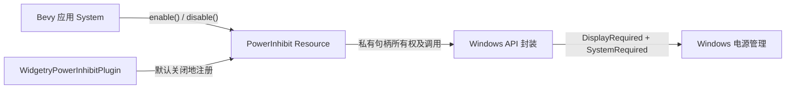
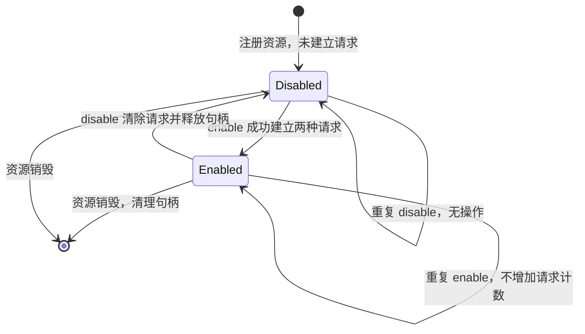

# 为 Bevy 应用增加 Windows 空闲息屏与休眠抑制插件

这个功能让 Bevy 0.20 应用在运行期间主动请求 Windows **不要因为用户长时间无操作而自动关闭显示器或进入系统休眠**。请求的生命周期由应用控制；窗口最小化、失去焦点或隐藏到托盘不改变请求状态。

独立交付物是一套可从 Bevy `ResMut<PowerInhibit>` 直接调用的 `enable()` / `disable()` 接口，以及内部可靠的 Windows 电源请求句柄管理。它是一项完整的小型功能增量：底层请求管理、Bevy 注册、错误处理和对应验证共同服务于同一个功能，不拆成只实现内部接口但无法在应用中使用的前置增量。

设计将“应用何时需要电源抑制”和“Windows 请求如何安全建立并释放”分开。应用只发出开启或关闭命令，插件保存实现所需的内部状态，不让窗口生命周期或轮询系统接管决策。



## 对外契约与插件接入

采用与现有独立功能 crate 一致的组织方式，新增一个 Windows x64 专用功能 crate，通过聚合 crate 的**可选依赖、feature 和模块导出**供调用方使用，并登记为 workspace 成员。无需依赖已有窗口、托盘插件，也不修改它们的行为。当前相关技术基线为 Bevy `0.20.0`、Rust edition `2024`，工作区同时采用严格的 Rust 与 Clippy lint。

插件命名为 `WidgetryPowerInhibitPlugin`。添加插件时仅注册**默认未启用**的 `PowerInhibit` 资源，不触发 Windows 电源请求。公共 API 为：

```rust
impl PowerInhibit {
    pub fn enable(&mut self) -> Result<(), PowerError>;
    pub fn disable(&mut self) -> Result<(), PowerError>;
}
```

错误类型在实现中可与现有错误约定衔接，但必须携带足以定位 Win32 调用失败的原因。应用不需要也不提供 `enabled` 或 `active` 字段；它们无法比同步调用的 `Result` 更准确地表达本次请求是否建立成功。内部仍需记录有效请求的所有权和成功建立的类型，不能因此做成完全无状态的函数。

例如，应用在确实需要保持运行时显式调用：

```rust
fn start_work(mut power: ResMut<PowerInhibit>) -> Result<(), PowerError> {
    power.enable()
}

fn finish_work(mut power: ResMut<PowerInhibit>) -> Result<(), PowerError> {
    power.disable()
}
```

`enable()`、`disable()` 都是同步方法，各自报告本次 Windows API 调用的结果。无需额外的状态同步 ECS System、每帧续期、窗口焦点观察者或后台定时轮询。重复开启不重复建立请求，重复关闭不清除不存在的请求。

## Windows 请求所有权与正常行为

采用 Windows 提供的四个 API：`PowerCreateRequest` 创建请求对象、`PowerSetRequest` 建立请求、`PowerClearRequest` 撤销对应请求、`CloseHandle` 释放对象句柄。请求属于资源内部管理的对象，不与窗口句柄或调用线程的活跃状态绑定。

创建请求时构造有效的 `REASON_CONTEXT`：正确填写版本、类型和可供系统展示的请求理由字符串，保证调用期间传入的指针及字符串有效。`PowerCreateRequest` 失败时会返回 `INVALID_HANDLE_VALUE`，不能将其作为正常句柄保存。

开启操作请求以下两种类型，二者组成一个不可对外拆分的功能：

- `PowerRequestDisplayRequired`：防止空闲超时让会话显示器自动关闭。
- `PowerRequestSystemRequired`：防止空闲超时让系统自动休眠。仅成功建立一种请求不等于整个操作成功。

状态变化围绕资源是否**已持有两种有效请求**：



Windows 为每种请求维护计数，因此启用和清除操作必须成对。这里不把每次调用都当作新的占用者：成功开启后，第二次 `enable()` 直接返回成功，不再调用 `PowerSetRequest`。关闭后，再次 `disable()` 不应调用 `PowerClearRequest`。请求对象在关闭时释放，下一次启用可以重新创建。

资源应承担 RAII 所有权：正常关闭主动释放，尚有请求时被移除或销毁也必须清理剩余句柄；进程异常终止时 Windows 会回收其持有的内核句柄。窗口最小化、失焦和托盘隐藏不应触发任何清理动作。

## 原生 API 与 Rust 安全边界

### 需要少量 `unsafe` 的原因

直接使用微软 `windows-rs` 的 Win32 绑定时，`PowerCreateRequest` / `PowerSetRequest` 属于 `unsafe` 函数；使用 `windows-sys` 时同样需要 `unsafe`。这是 Windows 原生 FFI 调用和指针、句柄生命周期约束所致，而不是 Bevy 的特殊限制。

优先沿用一个成熟的 Windows API 绑定（`windows` 或 `windows-sys`），在该 crate 内建立**私有的、尽可能小的安全封装**。公有 `PowerInhibit` API 保持安全 Rust。选择绑定时以目标 API、`REASON_CONTEXT` 和句柄释放的实际类型契约为依据，不再自行复制 Win32 FFI 声明。

### 只放宽新 crate 的 lint

`unsafe_code` 属于 `rustc` lint，不是 `clippy::` lint。现有工作区的 `[workspace.lints.rust] unsafe_code = "forbid"` 通过成员 crate 的 `[lints] workspace = true` 继承。`forbid` 不能被源码里的 `#[allow(unsafe_code)]` 降级；Cargo 也不允许同一个 `[lints]` 同时写 `workspace = true` 与逐项覆盖。

因此**新 crate 不使用 `[lints] workspace = true`**，改为自己的 `[lints.rust]` / `[lints.clippy]` 配置：保持工作区其他 Rust、Clippy 规则一致，仅将该 crate 的 `unsafe_code` 设置为 `deny` 而非 `forbid`，再仅对实际 FFI 封装模块使用局部 `#[allow(unsafe_code)]`。例如配置的关键差异是：

```toml
[lints.rust]
unsafe_code = "deny"
warnings = "deny"

# 同一 crate 的 [lints.clippy] 需逐项保留工作区的现有规则。
# 不能同时使用 [lints] workspace = true。
```

内部 FFI 模块中的每个 `unsafe` 块都要注明安全前提（有效句柄、指针与字符串有效期、Win32 调用结果检查、单次释放等）。其余代码仍受到 `unsafe_code = "deny"` 约束。保持其他 crate 的 `forbid` 完全不变；这不是把整个工作区的 `unsafe` 规则降级。

### 句柄与 `Resource` 的线程安全

在 `windows` 中，原始 `HANDLE` 包装了裸指针且**不实现 `Send` / `Sync`**；`windows-sys` 的 `HANDLE` 也直接是裸指针别名。普通 Bevy `Resource` / `ResMut` 所要求的线程安全不能从裸句柄自动推导出来。

既定对外接口是 `ResMut<PowerInhibit>`，因此实现必须在私有句柄所有者中解决线程安全契约，不能直接把原始 `HANDLE` 放进 `Resource` 后忽略编译错误，也不应无论证地添加 `unsafe impl Send/Sync`。需要依据所选绑定和 Windows 句柄的实际语义，审查单一所有权、可跨线程使用及释放的条件，并使裸句柄、转换和清理只在受审计的私有封装中出现。`enable()` / `disable()` 只通过 `&mut self` 修改所有权，避免并发重复设置、重复释放。如果采用 `unsafe impl`，其安全证明、封装不变量与调用约束必须写在对应实现附近。

## 失败处理与回收

`PowerCreateRequest` 使用无效句柄判断失败；`PowerSetRequest` 和 `PowerClearRequest` 以成功/失败返回值判断，失败时立即保留 Windows 错误码并传入 `PowerError`。`Result::Ok` 的含义是 Windows **已经成功接收这次请求**，不是承诺系统的全部电源策略永远服从请求。

- **部分开启成功**：如果显示器请求成功、系统请求失败，撤销先前成功的请求，释放句柄并返回错误；不得把部分成功对外报告为完整启用。反向调用顺序若出现对应问题，同样保证无悬空的半开启状态。
- **回滚本身失败**：仍需保证句柄所有权有明确归宿。记录未成功撤销的类型，并通过持有者清理；不能因为主调用已失败而丢失句柄，亦不能错误地再提交相同请求。关闭句柄时由 Windows 回收与其关联的请求。
- **清除请求失败**：向调用方返回错误；内部只标记真正清除成功的类型，保留剩余有效句柄和请求信息，允许之后再次尝试清理。不能因为部分失败就重置成“完全关闭”或再次递减已清除的计数。
- **销毁路径**：`Drop` 无法将错误作为方法 `Result` 返回，但必须尽力撤销剩余请求和释放句柄；清理错误可记录日志。进程退出后不应遗留该进程持有的请求。

上述规则需要通过可注入的调用边界或等效测试手段覆盖失败返回路径；不可依赖真实 Windows 环境随机触发错误来检验回滚。

## 验证与完成条件

这一增量的测试和验收与实现一起完成，不拆成独立的“测试阶段”。验证至少覆盖：

- **API / 默认值**：只添加插件时不存在 `DISPLAY` / `SYSTEM` 请求；可通过 Bevy `ResMut<PowerInhibit>` 调用 `enable()` / `disable()` 并取得 `Result`。没有公共 `enabled` / `active` 字段，也不需要更新时钟或轮询系统。
- **请求平衡**：首次 `enable()` 建立两种请求，重复 `enable()` 不重复计数；一次 `disable()` 完整清除，重复 `disable()` 不调用无效句柄；再次启用可以正常重新建立请求。
- **失败路径**：创建失败、两种请求中的任一设置失败、部分成功的回滚及回滚失败、清理失败与重试、销毁时仍持有句柄，均能正确传播或记录错误，不泄漏句柄、不把一个请求类型清除两次。
- **资源生命周期**：移除 `Resource`、正常应用退出时清理请求；窗口状态不会隐式修改资源持有的请求。原生句柄封装满足 `Resource` / `ResMut` 的 `Send + Sync` 要求，`unsafe` 只出现在经过说明的 Win32 边界。
- **Windows 实机检查**：以普通用户运行，在开关前后执行 `powercfg /requests`。启用时在 `DISPLAY`、`SYSTEM` 可见本进程请求；禁用与退出后请求消失。最小化、失去焦点和隐藏至托盘期间再检查一次，确认请求保留。
- **工程集成**：新 crate 及聚合 crate 的 feature、依赖、导出能够在 Windows x64 下构建和使用；保留现有其他 crate 的 lint 行为，并按新 crate 的本地规则运行 `cargo check`、Clippy 与相关测试。必要的 API 使用说明随代码提供。

## 功能边界

- 只支持 Windows 64 位，与现有平台限制一致；不额外适配 Linux、macOS 或 Web。
- 仅阻止**空闲超时**导致的自动息屏和休眠；不阻止用户明确触发的关机、休眠、合盖或电源按钮动作。
- 不提供独立屏保设置或修改电源计划的接口。`DisplayRequired` 可能由 Windows 自身联动影响空闲屏保及锁屏，但这不是插件独立控制的能力。
- 普通用户使用相关电源请求不需要 UAC 提权；系统仍可能依电源策略忽略或限制已接收的请求。特别是 Modern Standby 设备在电池供电时，对 `SystemRequired` 请求有额外时限。
- 不因为窗口被遮挡、隐藏、最小化而自动关闭请求；也不为窗口、托盘或系统生命周期引入额外观察逻辑。

## 实现参考

- [PowerCreateRequest](https://learn.microsoft.com/en-us/windows/win32/api/winbase/nf-winbase-powercreaterequest)、[PowerSetRequest](https://learn.microsoft.com/en-us/windows/win32/api/winbase/nf-winbase-powersetrequest)、[PowerClearRequest](https://learn.microsoft.com/en-us/windows/win32/api/winbase/nf-winbase-powerclearrequest)；含结果检查与引用计数规则。
- [POWER_REQUEST_TYPE](https://learn.microsoft.com/en-us/windows-hardware/drivers/ddi/wdm/ne-wdm-_power_request_type)、[REASON_CONTEXT](https://learn.microsoft.com/en-us/windows/win32/api/minwinbase/ns-minwinbase-reason_context)；含请求类型和原因字符串语义。
- [Cargo 工作区 lint 继承](https://doc.rust-lang.org/cargo/reference/workspaces.html)、[Rust forbid lint 行为](https://doc.rust-lang.org/reference/attributes/diagnostics.html)；含单 crate 特例限制。
- [Bevy Resource](https://docs.rs/bevy/0.20.0/bevy/prelude/trait.Resource.html)、[Windows HANDLE 类型](https://microsoft.github.io/windows-docs-rs/doc/windows/Win32/Foundation/struct.HANDLE.html)；含类型的 `Send` / `Sync` 约束。
